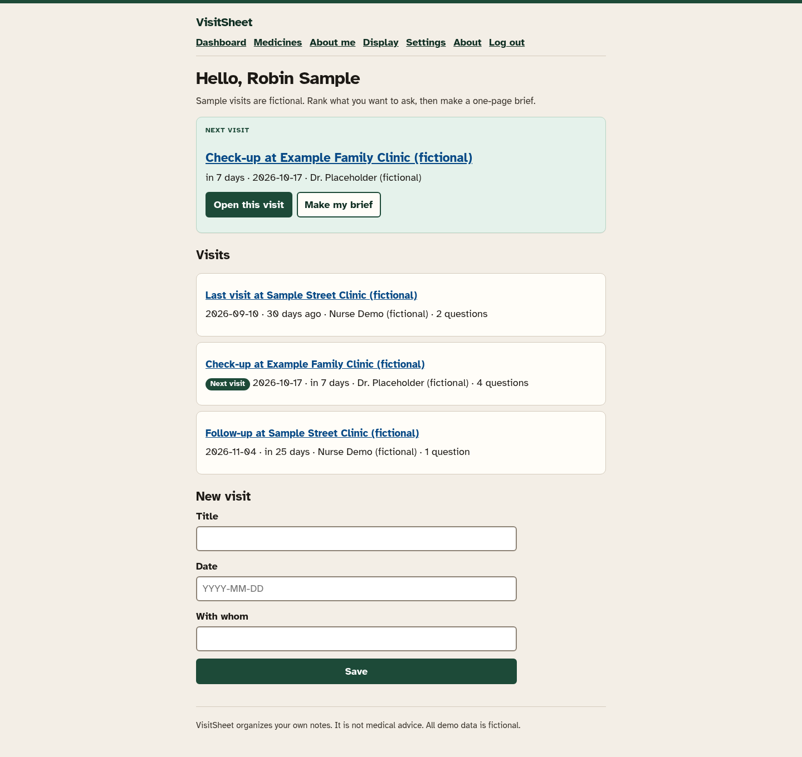
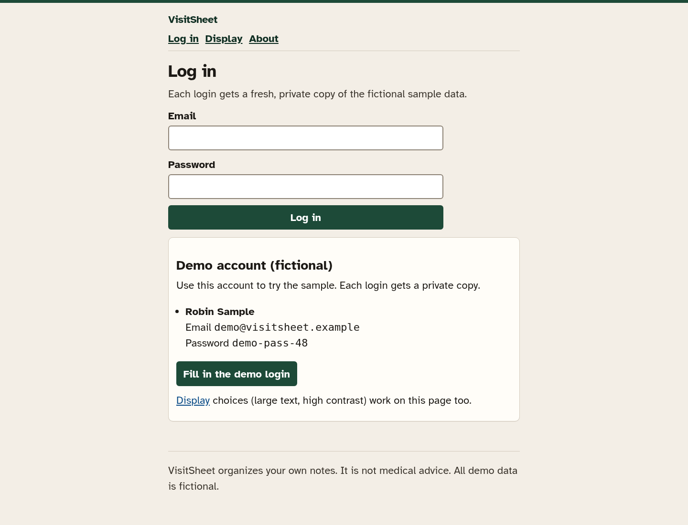
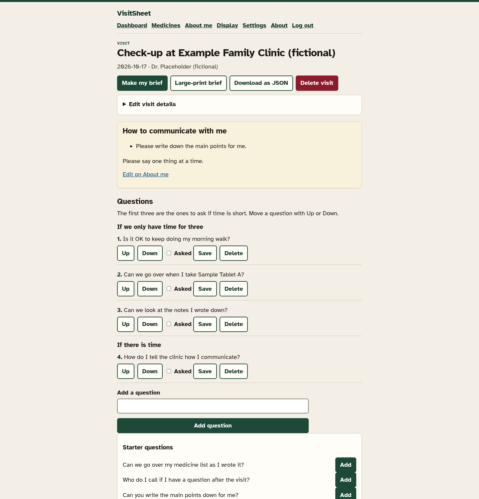
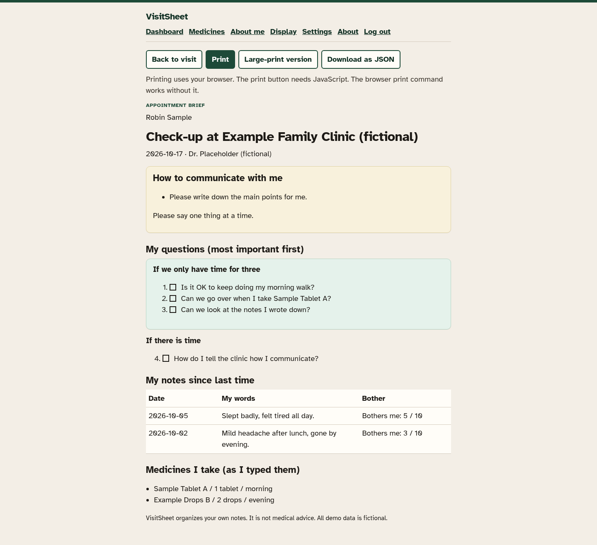
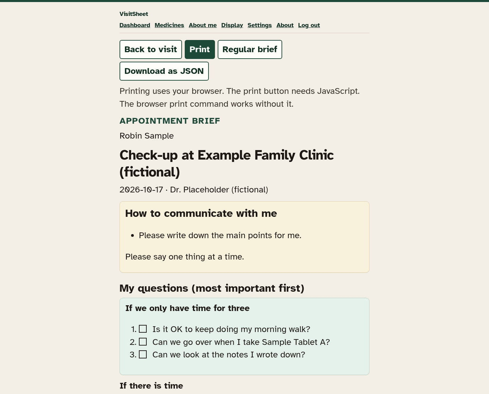
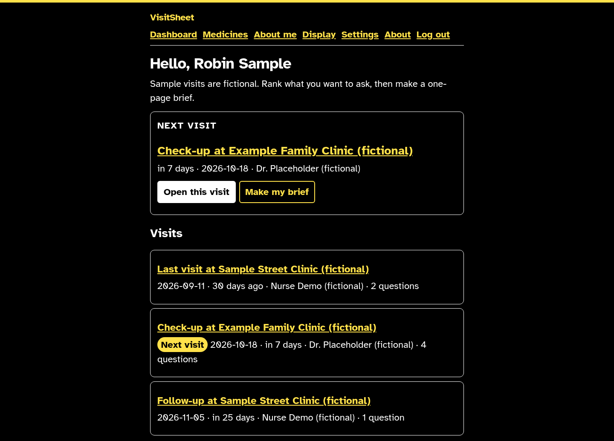

# VisitSheet

VisitSheet helps a person, or someone helping them, turn scattered notes into a one-page appointment brief. The first three questions sit in a box called “If we only have time for three.” Notes stay in the words that were typed. The medicine list is stored exactly as typed. A “How to communicate with me” card prints at the top of every brief.

VisitSheet organizes your own notes. It is not medical advice. All demo data is fictional.

It does not diagnose, check medicines, interpret the bother number, or suggest treatment. It is not for emergencies.



## Demo login (fictional)

| Who | Email | Password |
|---|---|---|
| Robin Sample | `demo@visitsheet.example` | `demo-pass-48` |

On the login page, **Fill in the demo login** fills this account. Each login gets a fresh private copy of the fictional sample, dated from that day, so two people never edit the same rows. The next visit is seven days ahead. A past visit already has asked ticks, takeaways, and one question that was not asked, ready to carry onto the next visit.



## Run

Node.js 22 LTS or newer. No API key and no `.env` file. The only optional environment variable is `PORT` (default `3000`).

```bash
npm install
npm run seed
npm start
```

Open http://localhost:3000

```bash
npm test
```

## What you can do

- Rank questions. The brief splits them at three.
- Correct a visit title, date, or “with whom” from **Edit visit details** without deleting the visit. The control is in the tab order: Enter or Space opens it.
- Add notes with a 0–10 “bothers me” number that you choose.
- Keep a medicine list in your own words.
- Mark questions asked, and write takeaways in your own words.
- Carry a question that was not asked last time onto this visit with **Add to this visit**.
- Print the brief, open a large-print version (larger on screen and in print), or download the same content as JSON.
- Set large text and high contrast on **Display**. That page works before login and stores a cookie.
- Set your name, a helper’s name, and eight communication choices on **About me**.
- Reset the fictional sample for the current login only.









More screenshots: [medicines](docs/screenshots/06-medicines.png), [display settings](docs/screenshots/07-display.png).

Pages work without JavaScript. The bother readout and the Print button are easier with JavaScript. Printing still works from the browser’s own print command.

## License

MIT License. Copyright 2026 Zhenhua Liu.

The interface uses [Atkinson Hyperlegible](https://www.brailleinstitute.org/freefont/), copyright 2020 Braille Institute of America, licensed under the SIL Open Font License 1.1 (`public/fonts/OFL.txt`).
